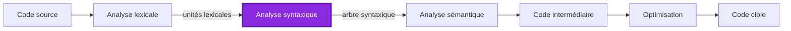
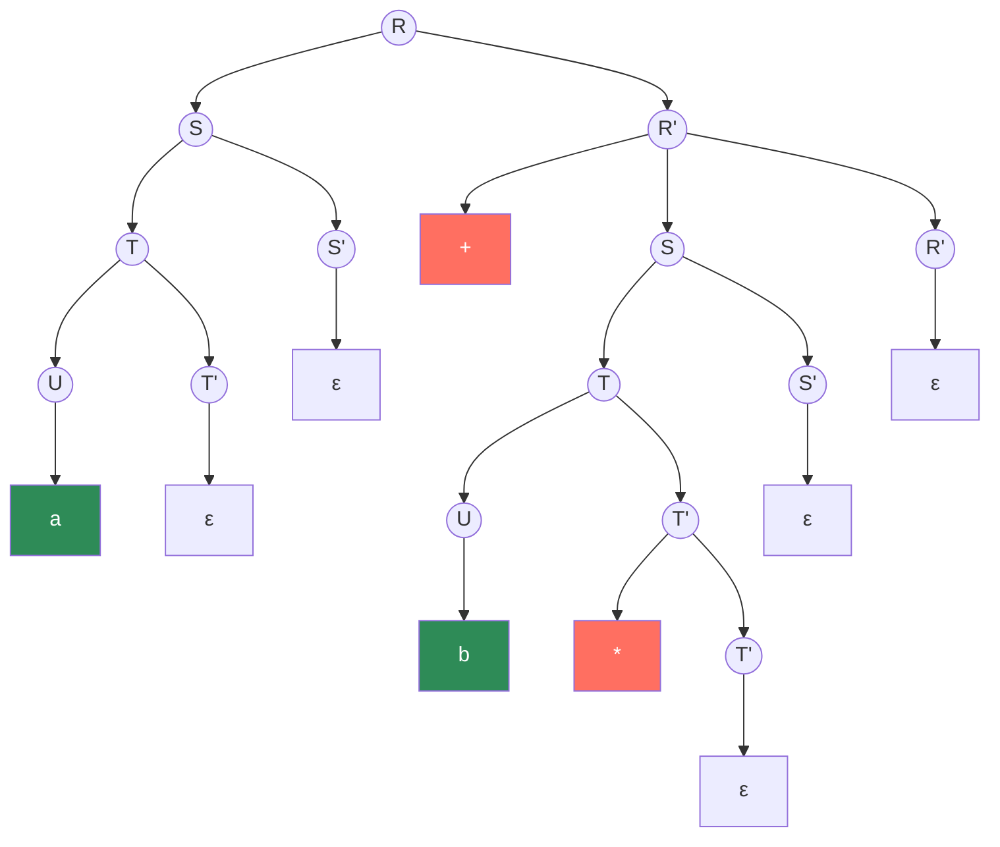
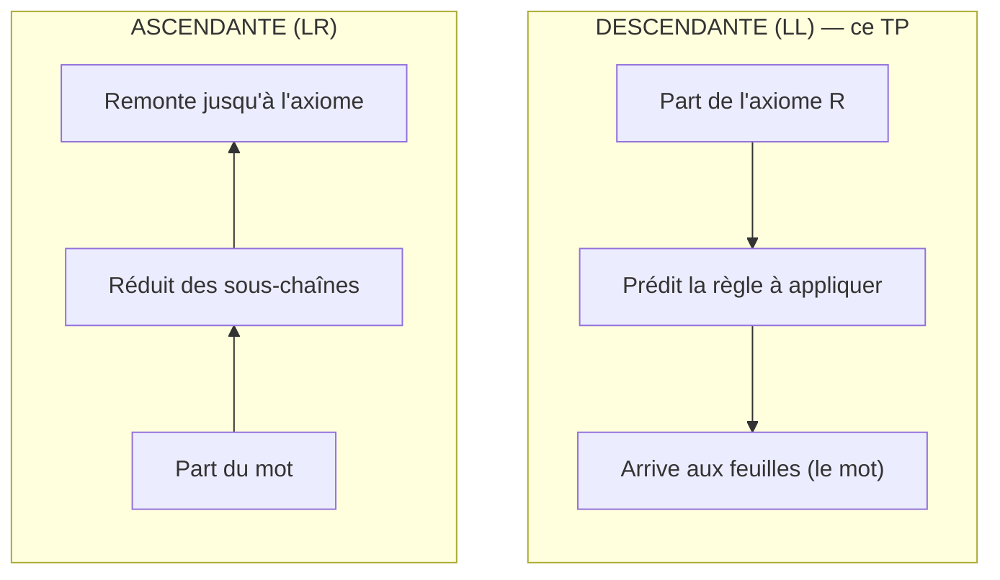
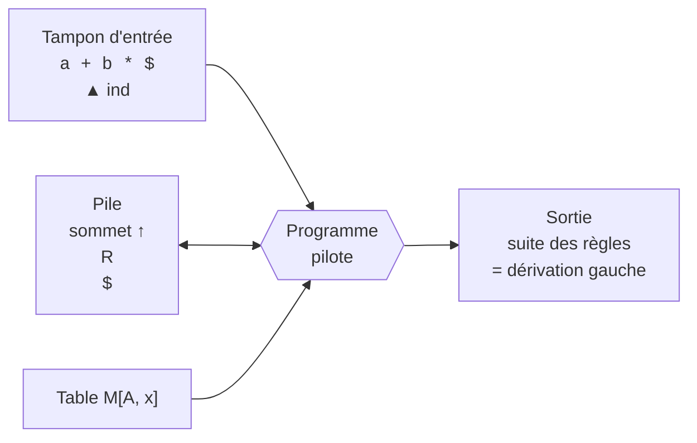
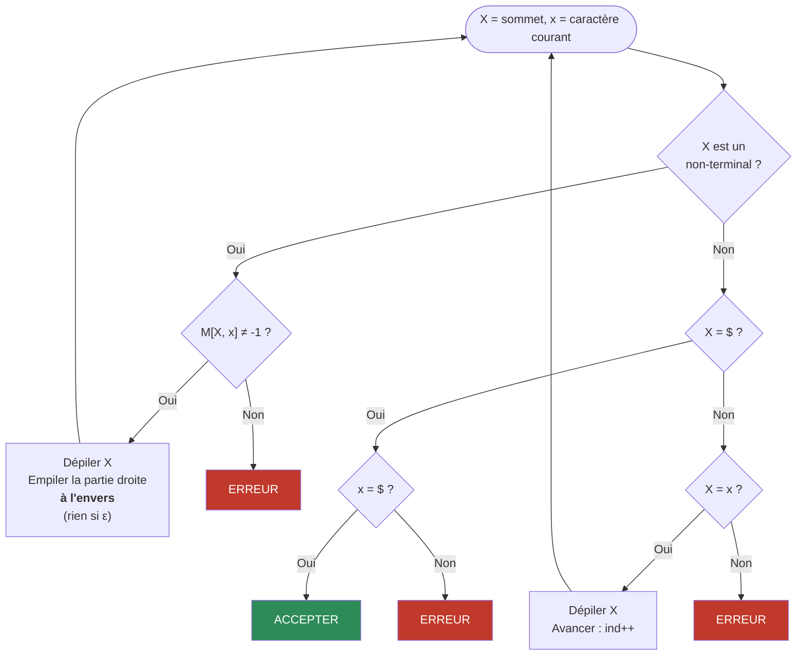
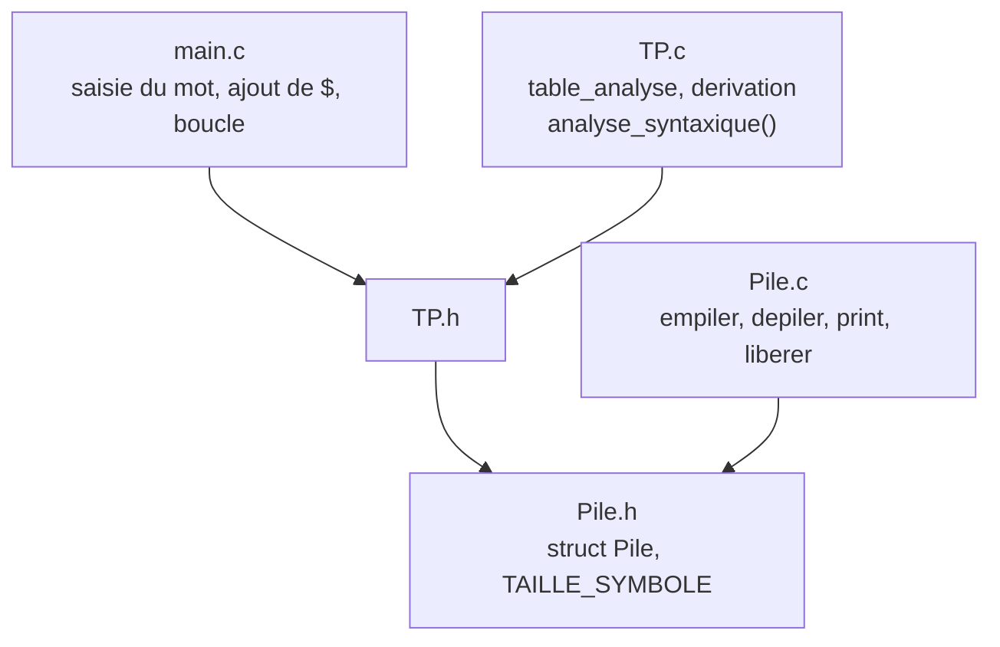

<div align="center">

# TP5 — Analyse Syntaxique LL(1)

### Un analyseur syntaxique descendant prédictif, piloté par table, écrit en C

*Reconnaître les expressions régulières sur l'alphabet `{a, b}` à l'aide d'une pile, d'une table d'analyse et d'une grammaire LL(1)*

<br/>

**Langage : C99** | **Méthode : LL(1)** | **Type : analyse descendante** | **Cours : Compilation** | **Plateformes : Windows, Linux et macOS**

<br/>

```
   Mot → [ Pile + Table LL(1) ] → ACCEPTER | ERREUR
```

</div>

---

## Sommaire

| # | Partie | Contenu |
|:-:|:--|:--|
| 1 | [Présentation](#1-présentation-du-projet) | Objectif, langage reconnu, aperçu |
| 2 | [Démarrage rapide](#2-démarrage-rapide) | Compilation, exécution, exemples |
| 3 | [Théorie](#3-fondements-théoriques) | Grammaires, dérivations, arbres, ambiguïté |
| 4 | [Transformer la grammaire](#4-de-la-grammaire-g-à-la-grammaire-ll1-g) | Récursivité à gauche, factorisation |
| 5 | [PREMIER & SUIVANT](#5-les-ensembles-premier-et-suivant) | Algorithmes et calcul complet |
| 6 | [Table d'analyse](#6-construction-de-la-table-danalyse-ll1) | Construction, conflits, condition LL(1) |
| 7 | [Algorithme pilote](#7-lalgorithme-danalyse-prédictive) | Automate à pile, pseudo-code |
| 8 | [Traces d'exécution](#8-traces-dexécution-commentées) | Mots acceptés et rejetés, pas à pas |
| 9 | [Architecture du code](#9-architecture-du-code) | Fichiers, structures, fonctions |
| 10 | [TP5 → NTP5](#10-évolution--de-tp5-à-ntp5) | Bugs corrigés et améliorations |
| 11 | [Exercices corrigés](#11-exercices-corrigés) | Pour s'entraîner et maîtriser |
| 12 | [Aller plus loin](#12-aller-plus-loin) | Limites, extensions, LL vs LR |
| 13 | [Glossaire & FAQ](#13-glossaire) | Vocabulaire et questions fréquentes |

---

## 1. Présentation du projet

Ce dépôt contient le **TP5 du module de Compilation**: la réalisation d'un **analyseur syntaxique descendant LL(1)** piloté par une **table d'analyse** et une **pile**.

L'analyseur lit un **mot** (une chaîne de caractères), lui ajoute le marqueur de fin `$`, puis décide si ce mot appartient au langage engendré par la grammaire. À chaque étape, il affiche l'état complet de l'analyse sur trois colonnes: **PILE**, **Entrée**, **Sortie**.

### Le langage reconnu

La grammaire décrit les **expressions régulières sur l'alphabet `{a, b}`**:

| Symbole | Rôle | Exemple | Priorité |
|:-:|:--|:--|:-:|
| `a`, `b` | lettres de l'alphabet | `a` | — |
| `( … )` | parenthésage | `(a+b)` | 1re (la plus forte) |
| `*` | étoile de Kleene (postfixe) | `a*` | 2e |
| *(juxtaposition)* | concaténation | `ab` | 3e |
| `+` | union (alternative) | `a+b` | 4e (la plus faible) |

> [!TIP]
> **Mots acceptés**: `a`, `ab`, `a+b`, `a*`, `ab**`, `(a+b)*a`, `((a))`, `a(b+a)*b`
> **Mots rejetés**: `+a`, `a+`, `()`, `(a`, `a)`, `*a`, `a+)`, `c`

### Contenu du dépôt

```text
TP5-Analyse-Syntaxique/
|-- NTP5/ (version corrigée et recommandée)
|   |-- main.c (saisie et lancement de l'analyse)
|   |-- TP.c / TP.h (table LL(1), règles et analyse)
|   `-- Pile.c / Pile.h (pile chaînée de symboles)
|-- TP5/ (version d'origine, conservée pour comparaison)
|-- .vs/ (fichiers Visual Studio à ignorer)
`-- TP5_Analyse_SYntaxique.pdf (énoncé du TP)
```

---

## 2. Démarrage rapide

### Compilation

<table>
<tr><th> Linux / macOS (GCC ou Clang)</th><th> Windows</th></tr>
<tr><td>

```bash
cd NTP5
gcc -Wall -Wextra -std=c99 \
    -o analyseur main.c TP.c Pile.c
./analyseur
```

</td><td>

```bat
:: MinGW
cd NTP5
gcc -std=c99 -o analyseur.exe main.c TP.c Pile.c
analyseur.exe

:: Visual Studio : ouvrir la solution
:: et lancer avec Ctrl + F5
```

</td></tr>
</table>

> [!NOTE]
> La version `NTP5` compile **sans aucun avertissement** avec `-Wall -Wextra -std=c99`. Elle est portable: `system("CLS")` et `system("PAUSE")` ne sont utilisés que sous Windows (`#ifdef _WIN32`).

### Utilisation

```text
Donner le mot (vide pour quitter) : a+b*
```

- Les **espaces sont ignorés** (`a + b *` équivaut à `a+b*`).
- Le programme ajoute lui-même le `$` de fin.
- Une **ligne vide** (ou `Ctrl+D` / `Ctrl+Z`) **quitte** le programme.
- La longueur d'un mot est limitée à **98 caractères**.

### Sortie obtenue

```text
PILE                          Entree                        Sortie

$R                            a+b*$                         R -> SR'
$R'S                          a+b*$                         S -> TS'
$R'S'T                        a+b*$                         T -> UT'
$R'S'T'U                      a+b*$                         U -> a
$R'S'T'a                      a+b*$
$R'S'T'                       +b*$                          T' -> epsilon
$R'S'                         +b*$                          S' -> epsilon
$R'                           +b*$                          R' -> +SR'
$R'S+                         +b*$
$R'S                          b*$                           S -> TS'
$R'S'T                        b*$                           T -> UT'
$R'S'T'U                      b*$                           U -> b
$R'S'T'b                      b*$
$R'S'T'                       *$                            T' -> *T'
$R'S'T'*                      *$
$R'S'T'                       $                             T' -> epsilon
$R'S'                         $                             S' -> epsilon
$R'                           $                             R' -> epsilon
$                             $                             ACCEPTER(analyse syntaxique reussie)

a+b* est connu
```

> [!IMPORTANT]
> **Comment lire la pile**: elle est affichée **du fond (à gauche) vers le sommet (à droite)**. Le symbole le plus à droite est donc celui que l'analyseur examine. Une ligne dont la colonne *Sortie* est vide correspond à la **consommation d'un terminal** (le sommet de pile coïncide avec le caractère courant).

---

## 3. Fondements théoriques

### 3.1 Où se situe l'analyse syntaxique?

Un compilateur traite un programme source en plusieurs phases successives. L'analyse syntaxique est la **deuxième**:



| Phase | Question posée | Outil théorique |
|:--|:--|:--|
| Analyse **lexicale** | « Les *mots* sont-ils bien formés? » | Expressions régulières, automates finis |
| Analyse **syntaxique** | « Les mots sont-ils *bien agencés*? » | **Grammaires hors-contexte**, automates à pile |
| Analyse **sémantique** | « La phrase a-t-elle un *sens*? » | Types, portée, attributs |

> Dans ce TP, chaque caractère (`a`, `b`, `+`, `*`, `(`, `)`) joue directement le rôle d'une **unité lexicale** (*token*): il n'y a donc pas d'analyseur lexical séparé.

### 3.2 Grammaire hors-contexte

Une **grammaire hors-contexte** (ou algébrique, *context-free*) est un quadruplet **G = (V<sub>T</sub>, V<sub>N</sub>, S, P)**:

| Élément | Signification | Dans ce TP |
|:-:|:--|:--|
| **V<sub>T</sub>** | Terminaux: symboles du texte analysé | `a b + * ( )` |
| **V<sub>N</sub>** | Non-terminaux: catégories syntaxiques | `R S T U` |
| **S** | Axiome: symbole de départ | `R` |
| **P** | Règles de production `A → α` | voir ci-dessous |

On l'appelle *hors-contexte* parce que le membre gauche de chaque règle est **un seul non-terminal**: `A` peut être remplacé par `α` quel que soit son contexte.

** Grammaire de départ G** (expressions régulières):

```
R → R + S  |  S          (union)
S → S T    |  T          (concaténation)
T → T *    |  U          (étoile)
U → ( R )  |  a  |  b    (éléments de base)
```

> **La hiérarchie encode la priorité**: plus un opérateur est *bas* dans la grammaire (proche de `U`), plus il est **prioritaire**. `*` (niveau `T`) l'emporte sur la concaténation (niveau `S`), qui l'emporte sur `+` (niveau `R`). Ainsi `a+bc*` se lit `a + (b(c*))`.

### 3.3 Dérivations

Une **dérivation** applique les règles, l'une après l'autre, pour passer de l'axiome à un mot.

- **Dérivation la plus à gauche** : on remplace toujours le non-terminal **le plus à gauche**. C'est celle que construit un analyseur **descendant**, donc celui de ce TP.
- **Dérivation la plus à droite**: on remplace toujours le non-terminal le plus à droite. Un analyseur **ascendant** (LR) construit l'inverse de cette dérivation.

**Exemple**: dérivation la plus à gauche de `a+b` dans G:

```
R ⇒ R + S ⇒ S + S ⇒ T + S ⇒ U + S ⇒ a + S ⇒ a + T ⇒ a + U ⇒ a + b
```

Le **langage engendré** est L(G) = { w ∈ V<sub>T</sub>* | R ⇒* w }: l'ensemble des mots de terminaux qu'on peut dériver à partir de l'axiome.

### 3.4 Arbre syntaxique

L'**arbre syntaxique** (ou arbre de dérivation) représente la structure d'un mot, sans tenir compte de l'ordre d'application des règles. Voici l'arbre de `a+b*` dans la grammaire transformée **G'** (celle qu'utilise le programme):



> Lues de gauche à droite, les **feuilles** de l'arbre (sans les ε) redonnent le mot: `a` `+` `b` `*`.

### 3.5 Ambiguïté

Une grammaire est **ambiguë** si un même mot possède **deux arbres syntaxiques différents**. Par exemple:

```
E → E + E  |  E E  |  E *  |  ( E )  |  a  |  b
```

Avec cette grammaire, `a+ab` a deux arbres: `(a+a)b` et `a+(ab)`. **Aucune grammaire ambiguë n'est LL(1).** C'est pourquoi la grammaire G du TP est **stratifiée** (R, S, T, U): chaque niveau correspond à un niveau de priorité, ce qui supprime l'ambiguïté.

### 3.6 Analyse descendante ou ascendante



| Critère | Descendante **LL(1)** | Ascendante **LR(1) / LALR(1)** |
|:--|:--|:--|
| Construction de l'arbre | Racine → feuilles | Feuilles → racine |
| Dérivation produite | La plus à gauche | La plus à droite (à l'envers) |
| Récursivité à gauche | interdite | acceptée |
| Puissance | Plus faible | Plus forte |
| Écriture à la main | facile | difficile (on utilise un générateur) |
| Outils | ANTLR, descente récursive | Yacc, Bison |

### 3.7 Que signifie « LL(1) »?

<div align="center">

| **L** | **L** | **(1)** |
|:-:|:-:|:-:|
| Lecture du mot de gauche à droite (*Left-to-right*) | Construction d'une dérivation la plus à gauche (*Leftmost*) | **1** seul symbole de pré-vision (*lookahead*) |

</div>

Un analyseur LL(1) **ne revient jamais en arrière**: en regardant uniquement le non-terminal en sommet de pile et **le caractère courant**, il sait quelle règle appliquer. C'est le rôle de la **table d'analyse**.

---

## 4. De la grammaire G à la grammaire LL(1) G'

La grammaire G **n'est pas LL(1)**: elle est **récursive à gauche** (`R → R + S`, `S → S T`, `T → T *`).

### 4.1 Pourquoi la récursivité à gauche pose problème

Supposons qu'on doive développer `R` avec la règle `R → R + S`. Le nouveau sommet de pile est encore `R`, sans qu'aucun caractère ait été lu. On réapplique la même règle, et ainsi de suite: la **boucle est infinie**.

### 4.2 Élimination de la récursivité gauche immédiate

> ** Règle de transformation**
>
> ```
> A → A α | β (β ne commence pas par A)
> ```
> devient
> ```
> A → β A'
> A' → α A' | ε
> ```
> Les deux grammaires engendrent le même langage: **β α α … α**.

**Application aux trois règles récursives:**

| Règle d'origine | A | α | β | Résultat |
|:--|:-:|:-:|:-:|:--|
| `R → R + S \| S` | R | `+ S` | `S` | `R → S R'` &nbsp; `R' → + S R' \| ε` |
| `S → S T \| T` | S | `T` | `T` | `S → T S'` &nbsp; `S' → T S' \| ε` |
| `T → T * \| U` | T | `*` | `U` | `T → U T'` &nbsp; `T' → * T' \| ε` |

### 4.3 Grammaire G' obtenue

| N° code | N° cahier | Règle | | N° code | N° cahier | Règle |
|:-:|:-:|:--|--|:-:|:-:|:--|
| **0** | 1 | `R → S R'` | | **6** | 7 | `T → U T'` |
| **1** | 2 | `R' → + S R'` | | **7** | 8 | `T' → * T'` |
| **2** | 3 | `R' → ε` | | **8** | 9 | `T' → ε` |
| **3** | 4 | `S → T S'` | | **9** | 10 | `U → ( R )` |
| **4** | 5 | `S' → T S'` | | **10** | 11 | `U → a` |
| **5** | 6 | `S' → ε` | | **11** | 12 | `U → b` |

> [!NOTE]
> Dans le code, les règles sont **numérotées à partir de 0** (indices du tableau C `derivation`). Le cahier du TP les numérote à partir de 1: **n° code = n° cahier − 1**.

### 4.4 L'autre transformation: la factorisation à gauche

Ce TP n'en a pas besoin, mais elle est indispensable en général. Quand deux règles d'un même non-terminal commencent par le même préfixe, l'analyseur ne peut pas choisir entre elles avec un seul symbole:

```
I → if C then I else I  |  if C then I
```
devient
```
I  → if C then I I'
I' → else I  |  ε
```

---

## 5. Les ensembles PREMIER et SUIVANT

Ces deux ensembles sont **la clé** de la construction de la table.

### 5.1 PREMIER(α) — *FIRST*

> **Définition**: PREMIER(α) est l'ensemble des **terminaux par lesquels peut commencer** un mot dérivé de α. On y ajoute **ε** si α ⇒* ε.

** Algorithme** (à répéter jusqu'à ce que plus rien ne change):

1. Si `x` est un terminal: PREMIER(x) = { x }.
2. Si `X → ε`: ajouter ε à PREMIER(X).
3. Si `X → Y₁ Y₂ … Yₖ`:
  - ajouter PREMIER(Y₁) \ {ε};
  - si ε ∈ PREMIER(Y₁), ajouter aussi PREMIER(Y₂) \ {ε}, et ainsi de suite;
  - si **tous** les Yᵢ peuvent produire ε, ajouter ε.

### 5.2 SUIVANT(A) — *FOLLOW*

> **Définition**: SUIVANT(A) est l'ensemble des **terminaux qui peuvent apparaître immédiatement à droite** de A dans une dérivation à partir de l'axiome. `$` appartient à SUIVANT de l'axiome.

** Algorithme** (à répéter jusqu'à ce que plus rien ne change):

1. Ajouter `$` à SUIVANT(axiome).
2. Pour toute règle `B → α A β`: ajouter PREMIER(β) \ {ε} à SUIVANT(A).
3. Pour toute règle `B → α A`, ou `B → α A β` avec ε ∈ PREMIER(β): ajouter SUIVANT(B) à SUIVANT(A).

> **Piège classique**: ε **n'appartient jamais** à un ensemble SUIVANT.

### 5.3 Calcul complet pour G'

<details open>
<summary><b> Calcul détaillé de PREMIER</b></summary>

<br/>

| Non-terminal | Raisonnement | PREMIER |
|:-:|:--|:-:|
| `U` | `U → ( R ) \| a \| b` | **{ (, a, b }** |
| `T'` | `T' → * T' \| ε` | **{ *, ε }** |
| `T` | `T → U T'` → PREMIER(U) | **{ (, a, b }** |
| `S'` | `S' → T S' \| ε` → PREMIER(T) ∪ {ε} | **{ (, a, b, ε }** |
| `S` | `S → T S'` → PREMIER(T) | **{ (, a, b }** |
| `R'` | `R' → + S R' \| ε` | **{ +, ε }** |
| `R` | `R → S R'` → PREMIER(S) | **{ (, a, b }** |

</details>

<details open>
<summary><b> Calcul détaillé de SUIVANT</b></summary>

<br/>

| Non-terminal | Raisonnement | SUIVANT |
|:-:|:--|:-:|
| `R` | axiome → `$`; dans `U → ( R )` → `)` | **{ $, ) }** |
| `R'` | `R → S R'` et `R' → + S R'` → SUIVANT(R) | **{ $, ) }** |
| `S` | suivi de `R'` → PREMIER(R') \ {ε} = {+}; R' ⇒ ε → SUIVANT(R) ∪ SUIVANT(R') | **{ +, $, ) }** |
| `S'` | en fin de `S → T S'` → SUIVANT(S) | **{ +, $, ) }** |
| `T` | suivi de `S'` → {(, a, b}; S' ⇒ ε → SUIVANT(S) ∪ SUIVANT(S') | **{ (, a, b, +, $, ) }** |
| `T'` | en fin de `T → U T'` et `T' → * T'` → SUIVANT(T) | **{ (, a, b, +, $, ) }** |
| `U` | suivi de `T'` → {*}; T' ⇒ ε → SUIVANT(T) | **{ *, (, a, b, +, $, ) }** |

</details>

### Récapitulatif

| | `R` | `R'` | `S` | `S'` | `T` | `T'` | `U` |
|:--|:-:|:-:|:-:|:-:|:-:|:-:|:-:|
| **PREMIER** | ( a b | + ε | ( a b | ( a b ε | ( a b | * ε | ( a b |
| **SUIVANT** | $ ) | $ ) | + $ ) | + $ ) | ( a b + $ ) | ( a b + $ ) | * ( a b + $ ) |

---

## 6. Construction de la table d'analyse LL(1)

### 6.1 Règles de remplissage

Pour chaque règle **`A → α`** de la grammaire:

1. pour chaque terminal **x ∈ PREMIER(α)**, placer la règle dans **M[A, x]**;
2. si **ε ∈ PREMIER(α)**, placer la règle dans **M[A, y]** pour chaque **y ∈ SUIVANT(A)** (y compris `$`);
3. chaque case restée vide est une **erreur** (codée `-1` dans le programme).

### 6.2 Table M obtenue (n° de règle du code)

<div align="center">

| **M** | `+` | `*` | `(` | `)` | `a` | `b` | `$` | *autre* |
|:-:|:-:|:-:|:-:|:-:|:-:|:-:|:-:|:-:|
| **R** | — | — | **0** | — | **0** | **0** | — | — |
| **R'** | **1** | — | — | *2* | — | — | *2* | — |
| **S** | — | — | **3** | — | **3** | **3** | — | — |
| **S'** | *5* | — | **4** | *5* | **4** | **4** | *5* | — |
| **T** | — | — | **6** | — | **6** | **6** | — | — |
| **T'** | *8* | **7** | *8* | *8* | *8* | *8* | *8* | — |
| **U** | — | — | **9** | — | **10** | **11** | — | — |

</div>

> **Légende** : **gras** = placé via PREMIER · *italique* = règle ε, placée via SUIVANT · — = erreur (`-1`)

Cette table est exactement le tableau `table_analyse[7][8]` de `NTP5/TP.c`:

```c
/* Colonnes :  +   *   (   )   a   b   $  autre */
int table_analyse[7][8] = {
    {-1, -1,  0, -1,  0,  0, -1, -1},   /* R  */
    { 1, -1, -1,  2, -1, -1,  2, -1},   /* R' */
    {-1, -1,  3, -1,  3,  3, -1, -1},   /* S  */
    { 5, -1,  4,  5,  4,  4,  5, -1},   /* S' */
    {-1, -1,  6, -1,  6,  6, -1, -1},   /* T  */
    { 8,  7,  8,  8,  8,  8,  8, -1},   /* T' */
    {-1, -1,  9, -1, 10, 11, -1, -1}    /* U  */
};
```

### 6.3 La grammaire G' est-elle LL(1)?

> **Critère**: une grammaire est LL(1) **si et seulement si** sa table ne contient **aucune case avec deux règles** (aucun conflit).

De manière équivalente, pour chaque paire de règles `A → α | β`:
- PREMIER(α) ∩ PREMIER(β) = ∅;
- au plus une des deux dérive ε;
- si β ⇒* ε, alors PREMIER(α) ∩ SUIVANT(A) = ∅.

**Vérification sur G'**:

| Paire | Test | Résultat |
|:--|:--|:-:|
| `R' → +SR' \| ε` | {+} ∩ SUIVANT(R') = {+} ∩ {$, )} | ∅ |
| `S' → TS' \| ε` | {(, a, b} ∩ {+, $, )} | ∅ |
| `T' → *T' \| ε` | {*} ∩ {(, a, b, +, $, )} | ∅ |
| `U → (R) \| a \| b` | {(}, {a}, {b} disjoints deux à deux | ∅ |

 **Aucun conflit: G' est LL(1).**

---

## 7. L'algorithme d'analyse prédictive

### 7.1 Le modèle: un automate à pile



**Initialisation**: la pile contient `$` puis l'axiome `R` au sommet; l'entrée contient `mot$`.

### 7.2 Les quatre cas possibles

Soit **X** le sommet de pile et **x** le caractère courant:



### 7.3 Pseudo-code

```text
fonction ANALYSE(mot$) :
    pile ← [$, R]                      // R au sommet
    ind  ← 0
    répéter
        X ← sommet(pile) ;  x ← mot[ind]
        si X est un non-terminal alors
            si M[X, x] = -1 alors retourner ERREUR
            soit X → Y1 Y2 … Yk la règle M[X, x]
            dépiler X
            si la règle n'est pas X → ε alors
                empiler Yk, …, Y2, Y1   // Y1 se retrouve au sommet
            afficher « X → Y1…Yk »
        sinon si X = $ alors
            si x = $ alors retourner ACCEPTER
            sinon retourner ERREUR
        sinon si X = x alors
            dépiler X ; ind ← ind + 1   // consommation
        sinon
            retourner ERREUR
```

> [!IMPORTANT]
> **Pourquoi empiler à l'envers?** Une pile est LIFO. Pour que **Y1**, le premier symbole de la partie droite, soit traité en premier, il doit se trouver **au sommet**. On empile donc Yk en premier et Y1 en dernier. C'est le rôle de la boucle `for (i = n - 1; i >= 0; i--)` dans `analyse_syntaxique()`.

### 7.4 Complexité

- **Temps**: O(n) pour un mot de longueur n. Chaque terminal est consommé une seule fois, et le nombre de développements entre deux consommations est borné par la grammaire.
- **Espace**: O(n) pour la pile, dans le pire cas (parenthèses imbriquées).

---

## 8. Traces d'exécution commentées

> Les traces ci-dessous ont été produites par le programme `NTP5`.

### Exemple 1: `(a+b)*a`, un mot accepté

<details>
<summary><b> Afficher la trace complète (33 étapes)</b></summary>

```text
PILE                          Entree                        Sortie

$R                            (a+b)*a$                      R -> SR'
$R'S                          (a+b)*a$                      S -> TS'
$R'S'T                        (a+b)*a$                      T -> UT'
$R'S'T'U                      (a+b)*a$                      U -> (R)
$R'S'T')R(                    (a+b)*a$
$R'S'T')R                     a+b)*a$                       R -> SR'
$R'S'T')R'S                   a+b)*a$                       S -> TS'
$R'S'T')R'S'T                 a+b)*a$                       T -> UT'
$R'S'T')R'S'T'U               a+b)*a$                       U -> a
$R'S'T')R'S'T'a               a+b)*a$
$R'S'T')R'S'T'                +b)*a$                        T' -> epsilon
$R'S'T')R'S'                  +b)*a$                        S' -> epsilon
$R'S'T')R'                    +b)*a$                        R' -> +SR'
$R'S'T')R'S+                  +b)*a$
$R'S'T')R'S                   b)*a$                         S -> TS'
$R'S'T')R'S'T                 b)*a$                         T -> UT'
$R'S'T')R'S'T'U               b)*a$                         U -> b
$R'S'T')R'S'T'b               b)*a$
$R'S'T')R'S'T'                )*a$                          T' -> epsilon
$R'S'T')R'S'                  )*a$                          S' -> epsilon
$R'S'T')R'                    )*a$                          R' -> epsilon
$R'S'T')                      )*a$
$R'S'T'                       *a$                           T' -> *T'
$R'S'T'*                      *a$
$R'S'T'                       a$                            T' -> epsilon
$R'S'                         a$                            S' -> TS'
$R'S'T                        a$                            T -> UT'
$R'S'T'U                      a$                            U -> a
$R'S'T'a                      a$
$R'S'T'                       $                             T' -> epsilon
$R'S'                         $                             S' -> epsilon
$R'                           $                             R' -> epsilon
$                             $                             ACCEPTER(analyse syntaxique reussie)

(a+b)*a est connu
```

</details>

** Moments clés:**
- Avec `U` en sommet et `(` en entrée, M[U, (] = 9: `U → (R)`. On empile `)`, `R`, `(` (à l'envers).
- Avec `R'` en sommet et `)` en entrée, M[R', )] = 2: `R' → ε`. La parenthèse fermante est dans SUIVANT(R'), donc l'union est terminée.
- Avec `S'` en sommet et `a` en entrée, M[S', a] = 4: `S' → TS'`. C'est la **concaténation** de `(a+b)*` avec `a`.

### Exemple 2 : `a+)`, un mot rejeté par un non-terminal

```text
$R'S+                         +)$
$R'S                          )$                            ERREUR!!

Mot inconnu : a+)
```

 **Diagnostic**: M[S, )] = −1. Après `+`, on attend le début d'un `S`, donc un symbole de PREMIER(S) = { (, a, b }. La parenthèse `)` n'en fait pas partie.

### Exemple 3 : `()`, un mot rejeté avec des parenthèses vides

```text
$R'S'T')R(                    ()$
$R'S'T')R                     )$                            ERREUR!!
```

 **Diagnostic**: M[R, )] = −1. La grammaire **interdit l'expression vide**: `R` ne peut pas dériver ε.

### Tableau de tests

| Mot | Résultat | Explication |
|:--|:-:|:--|
| `a` | Accepté | `U → a` |
| `ab**` | Accepté | double étoile: `T' → *T'` appliquée deux fois |
| `a+b*` | Accepté | union, puis étoile sur `b` |
| `(a+b)*a` | Accepté | parenthèses, étoile, concaténation |
| `((a))` | Accepté | imbrication de `U → (R)` |
| `a+)` | Rejeté | `)` ∉ PREMIER(S) |
| `()` | Rejeté | `R` ne dérive pas ε |
| `+a` | Rejeté | M[R, +] = −1 |
| `a+` | Rejeté | M[S, $] = −1 |
| `(a` | Rejeté | `$` rencontré alors que `)` est attendu |
| `c` | Rejeté | caractère hors alphabet (colonne *autre*) |

---

## 9. Architecture du code

### 9.1 Dépendances entre modules



### 9.2 La pile chaînée (`Pile.h` / `Pile.c`)

```c
#define TAILLE_SYMBOLE 8

typedef struct pile {
    char*        symbole;   /* "R", "R'", "+", "$", ...      */
    struct pile* svt;       /* élément situé en dessous      */
} Pile;
```

```text
   sommet
     │
     ▼
 ┌───────┐    ┌───────┐    ┌───────┐
 │  "S"  │───→│ "R'"  │───→│  "$"  │───→ NULL
 └───────┘    └───────┘    └───────┘
```

| Fonction | Rôle |
|:--|:--|
| `int empty(Pile*)` | Renvoie 1 si la pile est vide |
| `Pile* allocate(const char*)` | Crée un maillon (copie bornée du symbole) |
| `void empiler(Pile**, const char*)` | Ajoute un symbole au sommet |
| `void depiler(Pile**)` | Retire et libère le sommet |
| `void liberer(Pile**)` | Vide toute la pile (pas de fuite mémoire) |
| `int print(Pile*)` | Affiche la pile **du fond vers le sommet**, de façon récursive et **sans la modifier**. Renvoie le nombre de caractères affichés, utilisé pour aligner les colonnes |

### 9.3 Le cœur de l'analyse (`TP.h` / `TP.c`)

**Représentation des règles**. Chaque règle est stockée comme sa **partie droite**, sur 3 cases au plus. La sentinelle `"!"` marque les cases inutilisées:

```c
char derivation[12][3][8] = {
    {"S", "R'", "!"},        /* 0 : R  -> S R'   */
    {"+", "S",  "R'"},       /* 1 : R' -> + S R' */
    {"epsilon", "!", "!"},   /* 2 : R' -> ε      */
    ...
    {"(", "R",  ")"},        /* 9 : U  -> ( R )  */
    ...
};
```

| Fonction | Rôle |
|:--|:--|
| `check_terminal(c)` | Indique si `c` est un terminal (`+ * ( ) a b $`) |
| `get_indice_mot(c)` | Caractère → indice de colonne (0 à 7); 7 correspond à *autre* |
| `get_indice_non_terminal(nt)` | `"R"`, `"R'"`, … → indice de ligne (0 à 6), −1 si inconnu |
| `analyse_syntaxique(mot)` | Boucle pilote: affiche la trace, renvoie 1 (accepté) ou 0 (rejeté) |
| `erreur(mot)` / `accepter()` | Affiche le message et renvoie 0 / 1 |

> **Pourquoi des chaînes et pas des caractères?** Les non-terminaux `R'`, `S'` et `T'` s'écrivent avec **deux caractères**. Les symboles sont donc des chaînes, comparées avec `strcmp`.

---

## 10. Évolution: de `TP5` à `NTP5`

Le dossier `NTP5` est une **réécriture corrigée** de la version d'origine `TP5`. Les principales corrections:

| # | Problème dans `TP5` | Conséquence | Correction dans `NTP5` |
|:-:|:--|:--|:--|
| 1 | `print()` dépile puis ré-empile toute la pile pour l'afficher | Lent, avec des `malloc`/`free` à chaque ligne | `print(Pile*)` récursive en **lecture seule** |
| 2 | `int table_analyse[7][8];` est **défini** dans `TP.h` | Définitions multiples à l'édition de liens (GCC ≥ 10) | `extern` dans le `.h`, définition dans `TP.c` |
| 3 | Prototype `int empty(Pile)` alors que la fonction prend `Pile*` | Comportement indéfini | Prototype `int empty(Pile*)` |
| 4 | `s[ind++] = c` sans limite de taille | **Dépassement de tampon** | Lecture bornée par `MAX_MOT` |
| 5 | `char c` comparé à `EOF`, boucle `while(1)` | **Boucle infinie** en fin de fichier | `int c`, test de `EOF`, sortie sur mot vide |
| 6 | `strcpy` dans un tampon de 8 octets | Débordement possible | `strncpy` borné et `'\0'` forcé |
| 7 | `return` au milieu de la boucle, sans libérer la pile | **Fuite mémoire** | Une seule sortie, puis `liberer(&pile)` |
| 8 | Indice −1 pour un symbole inconnu, utilisé directement dans la table | Accès hors limites | Test `lig >= 0` |
| 9 | `<stdlib.h>` manquant dans `Pile.h` (`malloc`, `exit`) | Déclaration implicite | Inclusions complètes, gardes `#ifndef` |
| 10 | `system("CLS")` / `system("PAUSE")` | Fonctionne uniquement sous Windows | Macros `CLEAR()` / `PAUSE()` portables |
| 11 | Acceptation sur `$` sans vérifier la fin du mot | Fragile | Vérification de `ind == taille - 1` |

> [!TIP]
> **Conseil de dépôt**: ajoutez un `.gitignore` contenant `.vs/`, `*.exe`, `*.o`, `Debug/` et `Release/`. Les fichiers `.ipch`, `.suo` et `Browse.VC.db` sont des caches de Visual Studio, propres à chaque machine.

---

## 11. Exercices corrigés

<details>
<summary><b> Exercice 1: éliminer la récursivité à gauche de <code>E → E + T | E − T | T</code></b></summary>

<br/>

Ici α₁ = `+ T`, α₂ = `− T`, β = `T`:

```
E  → T E'
E' → + T E'  |  − T E'  |  ε
```

</details>

<details>
<summary><b> Exercice 2: calculer PREMIER et SUIVANT pour la grammaire arithmétique classique</b></summary>

<br/>

```
E → T E'        E' → + T E' | ε
T → F T'        T' → * F T' | ε
F → ( E ) | id
```

| | E | E' | T | T' | F |
|:--|:-:|:-:|:-:|:-:|:-:|
| PREMIER | ( id | + ε | ( id | * ε | ( id |
| SUIVANT | $ ) | $ ) | + $ ) | + $ ) | * + $ ) |

</details>

<details>
<summary><b> Exercice 3: cette grammaire est-elle LL(1)? <code>S → a S b | a b</code></b></summary>

<br/>

 **Non**: PREMIER(aSb) ∩ PREMIER(ab) = {a}, donc M[S, a] contient deux règles.
 **Après factorisation à gauche**:

```
S  → a S'
S' → S b  |  b
```

PREMIER(Sb) = {a} et PREMIER(b) = {b} sont disjoints: la grammaire devient LL(1).

</details>

<details>
<summary><b> Exercice 4: simuler l'analyse de <code>ba*</code> à la main</b></summary>

<br/>

| Pile | Entrée | Action |
|:--|:--|:--|
| `$R` | `ba*$` | R → SR' |
| `$R'S` | `ba*$` | S → TS' |
| `$R'S'T` | `ba*$` | T → UT' |
| `$R'S'T'U` | `ba*$` | U → b |
| `$R'S'T'b` | `ba*$` | consommer `b` |
| `$R'S'T'` | `a*$` | T' → ε |
| `$R'S'` | `a*$` | S' → TS' |
| `$R'S'T` | `a*$` | T → UT' |
| `$R'S'T'U` | `a*$` | U → a |
| `$R'S'T'a` | `a*$` | consommer `a` |
| `$R'S'T'` | `*$` | T' → *T' |
| `$R'S'T'*` | `*$` | consommer `*` |
| `$R'S'T'` | `$` | T' → ε |
| `$R'S'` | `$` | S' → ε |
| `$R'` | `$` | R' → ε |
| `$` | `$` | ACCEPTER |

L'étoile s'applique **seulement à `a`**: `b(a*)`.

</details>

<details>
<summary><b> Exercice 5: ajouter le mot vide <code>ε</code> (symbole <code>e</code>) au langage</b></summary>

<br/>

1. Ajouter la règle **12: `U → e`**, c'est-à-dire `{"e", "!", "!"}` dans `derivation` (`maxDeri_i` passe à 13).
2. Ajouter une colonne `e` à la table (`table_analyse[7][9]`) et le cas `'e'` dans `get_indice_mot`.
3. Mettre à jour PREMIER: `e` apparaît partout où se trouvent `a` et `b`. Les cases de la colonne `e` reprennent donc les valeurs de la colonne `a`, sauf M[U, e] = 12.
4. Ajouter `'e'` à `check_terminal`.

</details>

<details>
<summary><b> Exercice 6 (défi): remplacer la table par une descente récursive</b></summary>

<br/>

Chaque non-terminal devient une fonction. La pile du programme est remplacée par la **pile d'appels** du langage C:

```c
static const char* p;                 /* caractère courant */

static int R(void); static int S(void); static int T(void); static int U(void);

static int U(void) {
    if (*p == 'a' || *p == 'b') { p++; return 1; }
    if (*p == '(') { p++; if (!R()) return 0; if (*p != ')') return 0; p++; return 1; }
    return 0;
}
static int T(void) { if (!U()) return 0; while (*p == '*') p++; return 1; }             /* T' itératif */
static int S(void) { if (!T()) return 0; while (*p=='('||*p=='a'||*p=='b') if (!T()) return 0; return 1; }
static int R(void) { if (!S()) return 0; while (*p == '+') { p++; if (!S()) return 0; } return 1; }

int reconnait(const char* mot) { p = mot; return R() && *p == '$'; }
```

 La boucle `while` de chaque fonction joue le rôle des règles en `X'`: c'est la récursivité terminale, écrite de façon itérative.

</details>

---

## 12. Aller plus loin

### Limites de la version actuelle

- Pas de **récupération sur erreur**: l'analyse s'arrête à la première erreur.
- Pas de **construction d'arbre**: le programme reconnaît le mot mais ne le représente pas en mémoire.
- La table est **écrite à la main**: chaque modification de la grammaire oblige à la recalculer.

### Idées d'extensions

| Niveau | Idée |
|:-:|:--|
| Niveau 1 | Indiquer la **position** et les **symboles attendus** en cas d'erreur (par exemple « attendu : ( a b ») |
| Niveau 2 | **Mode panique** : en cas d'erreur, ignorer des caractères jusqu'à trouver un symbole de SUIVANT, puis reprendre |
| Niveau 2 | Construire l'**arbre syntaxique** et l'exporter au format Graphviz (`.dot`) |
| Niveau 3 | **Générer la table automatiquement** à partir d'un fichier de grammaire (calcul de PREMIER, SUIVANT et M) |
| Niveau 3 | Compiler l'expression régulière reconnue en **automate de Thompson** (lien avec l'analyse lexicale) |

### La hiérarchie des grammaires

```mermaid
flowchart LR
    LL0[LL&#40;0&#41;] --> LL1[LL&#40;1&#41;] --> LLk[LL&#40;k&#41;]
    LL1 --> LALR[LALR&#40;1&#41;] --> LR1[LR&#40;1&#41;]
    LLk -.-> LR1
    LR1 --> CFG[Grammaires non ambiguës]
    CFG --> ALL[Grammaires hors-contexte]
```



> Toute grammaire LL(1) est LR(1), mais **la réciproque est fausse**. C'est pour cette raison que les générateurs industriels (Yacc, Bison) utilisent LALR(1), tandis qu'ANTLR utilise une forme étendue de LL appelée **ALL(\*)**.

### Pour approfondir

- **Aho, Lam, Sethi, Ullman**: *Compilateurs: principes, techniques et outils* (le « Dragon Book »), chapitre 4.
- **Grune & Jacobs**: *Parsing Techniques: A Practical Guide*.
- L'énoncé du TP: `TP5_Analyse_SYntaxique.pdf`.

---

## 13. Glossaire

| Terme | Définition |
|:--|:--|
| **Axiome** | Non-terminal de départ de la grammaire (ici `R`) |
| **Terminal** | Symbole qui apparaît dans le mot analysé (`a`, `+`, …) |
| **Non-terminal** | Catégorie syntaxique, remplacée par des règles (`R`, `S'`, …) |
| **Production** | Règle de réécriture `A → α` |
| **Dérivation** | Suite d'applications de règles |
| **ε (epsilon)** | Mot vide |
| **Pré-vision (*lookahead*)** | Caractère courant, consulté sans être consommé |
| **PREMIER / FIRST** | Terminaux par lesquels peut commencer une forme dérivée |
| **SUIVANT / FOLLOW** | Terminaux qui peuvent suivre un non-terminal |
| **Conflit LL(1)** | Case de la table contenant plusieurs règles |
| **Récursivité à gauche** | Règle de la forme `A → A α` |
| **Factorisation** | Mise en commun d'un préfixe partagé par plusieurs règles |
| **`$`** | Marqueur de fin d'entrée et de fond de pile |

## FAQ

<details>
<summary><b>Pourquoi le programme affiche-t-il <code>$</code> à la fin de l'entrée?</b></summary>
<br/>
Le <code>$</code> est ajouté par <code>main.c</code> (<code>strcat(ss, "$")</code>). Il permet à l'analyseur de savoir que le mot est terminé et d'appliquer les règles ε grâce aux ensembles SUIVANT, qui contiennent <code>$</code>.
</details>

<details>
<summary><b>Pourquoi certaines lignes n'ont-elles rien dans la colonne « Sortie »?</b></summary>
<br/>
Ce sont les étapes de <b>consommation</b>: le sommet de pile est un terminal égal au caractère courant. On le dépile et on avance dans l'entrée, sans appliquer de règle.
</details>

<details>
<summary><b>Pourquoi les espaces sont-ils ignorés?</b></summary>
<br/>
<code>main.c</code> les filtre pendant la saisie (<code>if (c!= ' ')</code>). Ils ne font pas partie de l'alphabet. Ce filtrage est une forme très simple d'analyse lexicale.
</details>

<details>
<summary><b>Les deux règles 3 (<code>S → TS'</code>) et 4 (<code>S' → TS'</code>) ont la même partie droite: est-ce une erreur?</b></summary>
<br/>
Non. Leurs parties gauches sont différentes (<code>S</code> et <code>S'</code>). Comme le tableau <code>derivation</code> ne stocke que les parties droites, les deux lignes sont identiques. Le programme affiche la bonne partie gauche, car il la lit dans la pile.
</details>

<details>
<summary><b>Le programme gère-t-il les mots très longs?</b></summary>
<br/>
Dans <code>NTP5</code>, la saisie est limitée à 98 caractères (<code>MAX_MOT</code>); les caractères suivants sont ignorés. L'alignement des colonnes est prévu pour des mots et des piles d'environ 30 caractères.
</details>

---

<div align="center">

### En résumé

**Grammaire G** → *éliminer la récursivité à gauche* → **Grammaire G'** → *calculer PREMIER et SUIVANT* → **Table M** → *vérifier l'absence de conflit* → **Analyseur à pile**

<br/>

*Réalisé dans le cadre du module de **Compilation**: TP5, Analyse Syntaxique*

*Si ce dépôt vous a aidé à comprendre l'analyse LL(1), n'hésitez pas à lui donner une étoile !*

</div>
